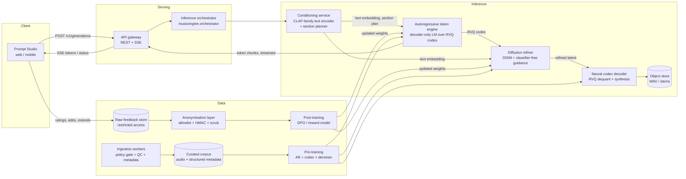

# Music Generation Engine: Architecture

This document describes the target system, the services that make it up, and
which parts of it this repository implements today. Section 6 is the status
ledger; read it before relying on any component.

## 1. System diagram



## 2. Service breakdown

| Service | Responsibility | Inputs → outputs | Code |
|---|---|---|---|
| **Prompt Studio** (frontend) | Structured controls (genre, mood, instruments, tempo, key), free text, lyrics editor with `[Section]` tags, live token/progress stream | user input → `GenerationRequest` | Not in this repo |
| **API gateway** | Validation, idempotency keys, auth, rate limits, SSE fan-out, audio download with Range | HTTP → job lifecycle | `schemas.py`, `docs/api/openapi.yaml` |
| **Conditioning service** | Canonicalises all text fields, encodes into the shared audio-text space, plans section timing from lyrics | request → `Conditioning` (embedding, section frames) | `conditioning.py` |
| **Autoregressive token engine** | Decoder-only LM that predicts interleaved RVQ tokens frame by frame. Owns macro structure, melody, harmony, rhythm. Enforces per-level codebook constraints | conditioning → streamed `TokenChunk`s | `engine/autoregressive.py` |
| **Diffusion refiner** | DDIM sampler in codec-latent space, starting from Gaussian noise. Conditioned on the token prior and the text embedding; CFG over text | token prior + embedding → refined latent | `engine/diffusion.py` |
| **Neural codec decoder** | Latent → stereo waveform, peak-safe output | latent → `(2, T)` float audio | `codec.py`, `audio_io.py` |
| **Inference orchestrator** | Runs stages, emits status and token events, checks cancellation between chunks, records per-stage timings | request → events + `RenderResult` | `orchestrator.py` |
| **Ingestion workers** | Policy gate (tiers, licences, robots, paywalls), signal QC, metadata cleaning, audit log of every exclusion | manifest → `accepted.jsonl`, `rejected.jsonl` | `data/policy.py`, `data/quality.py`, `data/metadata.py`, `data/ingest.py` |
| **Anonymisation layer** | Allowlisted fields only, keyed pseudonyms that rotate per epoch, free-text PII scrubbing, final assertion gate | raw feedback → post-training rows | `privacy.py` |
| **Post-training** | Folds implicit and explicit signals into scores, builds preference pairs for DPO or reward modelling | rows → pairs | `posttrain.py` |
| **Training pipeline** | Pre-training of the codec, token LM and denoiser on the curated corpus; alignment runs on post-training pairs | corpus → checkpoints | Design only |

## 3. Data flow: a generation request

1. `GenerationRequest` is validated (ranges, key pattern, tag normalisation, instrumental/lyrics exclusivity).
2. **Conditioning.** `canonical_text` renders every field into a labelled string. The text encoder maps it to a unit vector in the shared space. `plan_sections` splits the frame budget across lyric sections, weighted by word count.
3. **Tokens.** The AR engine samples frame by frame. At each position it masks logits to the valid range for that RVQ level, so a level-2 token cannot appear where a level-0 token is due. Chunks of 25 frames (0.5 s) are emitted as `TokenEvent`s. Chunks never span a section boundary.
4. **Refinement.** Codes are dequantised into a prior latent. The DDIM sampler starts from Gaussian noise at `t = T` and denoises. At each step it computes the conditional noise prediction and the unconditional one (token prior only), then combines them with guidance scale `w`. The result is a latent that follows the tokens and carries the prompt's colour.
5. **Decode.** The codec maps the latent to stereo audio. Output is peak-normalised to −1 dBFS and clipped to [−1, 1].

Cancellation is checked between every chunk and between stages, so a cancelled job stops within about 0.5 s of audio.

## 4. Data model

```
GenerationRequest ──► Conditioning ──► TokenChunk* ──► prior latent ──► RenderResult
     │                                     │
     └── job_id ─────────────────► GenerationJob (status, progress, audio_url)
                                           │
                                           └── FeedbackEvent (raw, restricted)
                                                    │  anonymize_feedback()
                                                    ▼
                                             PostTrainRow (allowlisted, pseudonymous)
                                                    │  score_generations() → build_preference_pairs()
                                                    ▼
                                             PreferencePair {prompt_hash, chosen, rejected, margin}
```

Token vocabulary, for an RVQ with `Q` levels and codebook size `K`:

```
0 PAD | 1 BOS | 2 EOS | 3..18 section markers | 19 + q*K + k  acoustic (level q, code k)
```

Acoustic tokens are frame-major: frame `t` emits `Q` tokens, so stream position `p` is level `p mod Q`.

## 5. Governance

**Pre-training sources.** Two tiers, enforced in code (`data/policy.py`):

- **OPEN_WEB.** Requires a permitted licence (CC0, CC-BY, CC-BY-SA, public domain), a robots.txt decision that is explicitly "allowed", and no paywall or access control. The worker never fetches anything; it only reads files that an upstream, policy-checked acquisition step has already placed on disk.
- **LICENSED (v6+).** Off by default. Requires an active contract id in the policy allowlist and `allow_licensed=True`.

Named metadata sources (YouTube Music, Genius, Deezer) are not wired to audio acquisition. Their terms generally prohibit bulk downloading and scraping, and bypassing paywalls or access controls is out of scope. Metadata should come through each provider's official API under its own licence.

**Post-training.** Feedback is stored raw with restricted access. Only the output of `anonymize_feedback` may enter a training dataset. That output has an explicit field allowlist, keyed HMAC pseudonyms for users, generations and events (rotated per epoch, key held outside the data store), scrubbed free text, day-level timestamps, and a final `assert_no_pii` check that raises rather than writes.

## 6. Status ledger

| Component | Status | What it is today | What production needs |
|---|---|---|---|
| Schemas, API contract | **Implemented** | pydantic models; OpenAPI 3.1; tests keep them in sync | HTTP server (not included) |
| Orchestrator | **Implemented** | streaming, cancellation, timings, determinism per seed | Async job queue, GPU workers, retries |
| Section planning | **Implemented** | exact frame allocation, lyric-weighted | Learned section timing |
| Text encoder | **Placeholder** | `HashingTextEncoder` (feature hashing). Same contract, no semantics | CLAP-family model with trained weights |
| RVQ codec | **Reference, low fidelity** | real RVQ with residual k-means over a DCT bottleneck. Content above about 3.2 kHz is removed entirely (measured: a 6 kHz tone reconstructs at 0 dB SNR). A 200 Hz tone reconstructs at about 7 dB SNR. Quantiser depth does reduce latent error monotonically (tested) | Trained conv encoder/decoder (EnCodec-style), full band, stereo at 44.1 kHz |
| AR token LM | **Placeholder** | `ReferenceTokenLM` (conditioning projection + temporal prior). Real sampling, masking and streaming | Decoder-only transformer with KV cache, trained on the corpus |
| Diffusion denoiser | **Placeholder** | analytic `ReferenceDenoiser`. Real DDIM sampler and CFG | U-Net / DiT noise predictor, trained |
| Quality filters | **Implemented** | SNR proxy, effective bandwidth, clipping, silence, loudness, corruption | Tuned thresholds from listening tests |
| Metadata cleaning | **Implemented** | taxonomy, key validation, tempo estimate, lyric/duration alignment | Richer genre model; key estimation from audio |
| Ingestion policy | **Implemented** | tiers, licence allowlist, robots, paywall gate, audit log | Acquisition adapters that pass the same gate |
| Anonymisation | **Implemented** | allowlist, HMAC pseudonyms, scrubbing, final gate | Formal review; a DPIA before any real user data is used |
| Post-training | **Implemented (data side)** | scoring and preference pairs | DPO / reward-model training loop |
| Pre-training | **Not implemented** | design only | Distributed training on tens of millions of tracks |
| Prompt Studio UI | **Not implemented** | design only | Frontend project |

Quality claims. Nothing here measures musical quality. The reference components demonstrate the contracts, the numerical methods and the control flow, not the model behaviour. Real evaluation needs held-out listening tests, FAD (Fréchet audio distance) against a reference set, and CLAP-score alignment on prompts.
